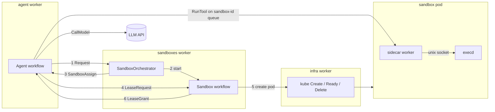

# temporal-agent-sandbox

A small, working example of an LLM agent run as a durable [Temporal](https://temporal.io) workflow, whose tool calls execute inside a disposable Kubernetes pod.

- **Agent** — one LLM conversation. Each turn calls the model, then runs the tool calls it returns on the sandbox's own task queue. It renews its lease before expiry and continues-as-new every 50 turns.
- **SandboxOrchestrator** — a singleton that starts one Sandbox per request and tells the agent its id.
- **Sandbox** — owns one pod: renders a Helm chart, creates the pod, waits until it is ready, grants leases, and deletes the pod once it has gone unleased past a grace period.
- **Sidecar** — a Temporal worker inside the pod. It runs each command through `execd`, an exec server in the sandbox container that only the sidecar's UID may call.

Only the infra worker holds cluster credentials; agents reach sandboxes through signals and task queues alone.

## Layout

| Path | |
|---|---|
| `twf/` | The design, written before the code in [TWF](https://www.npmjs.com/package/@temporal-architect/twf) |
| `proto/`, `gen/`, `lib/` | Contracts, generated Temporal stubs, implementations |
| `cmd/workers/`, `lib/workers/` | The four workers |
| `cmd/execd`, `lib/execd/` | The exec server |
| `helm/sandbox` | The sandbox pod chart |
| `e2e/` | Runs an agent through every worker against k3s and a stub model |

`make help` lists targets. `make test` runs unit and replay tests; `make test-integration` needs Docker.
