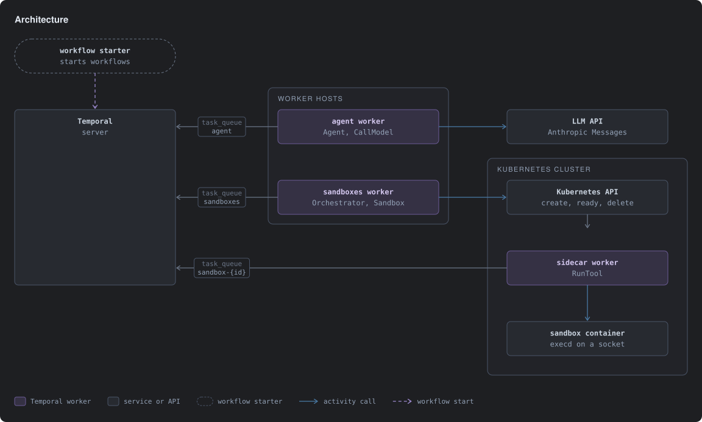
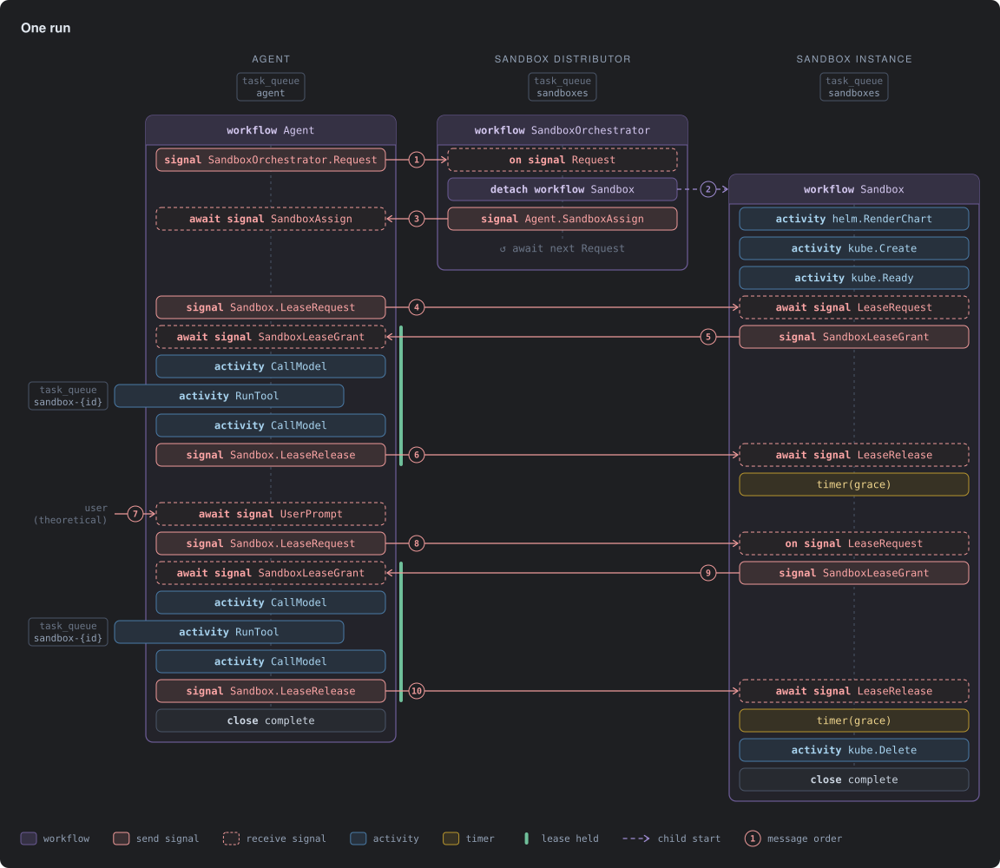

# Durable agents, disposable sandboxes

An educational example: an LLM agent run as a durable [Temporal](https://temporal.io) workflow, its tool calls executed in a disposable Kubernetes pod. Designed in [TWF](https://www.npmjs.com/package/@temporal-architect/twf) with [Temporal Architect](https://github.com/jmbarzee/temporal-architect): the `.twf` files in `twf/` are the source of truth.

## Principles

- **The conversation is workflow state**, so it outlives any worker.
- **Each pod has one authority**, its `Sandbox` workflow, and only that workflow's worker holds cluster credentials.
- **Access is leased.** Tools run only under a lease, and an unleased sandbox deletes its pod after a grace period, so a crashed agent leaks nothing.
- **A task queue is the only path to a pod.** Agents never address the cluster or the pod.
- **A retry reuses finished work.** The sidecar keeps each call's output, so retrying a `RunTool` that finished runs nothing.
- **The design leads the code.** A change starts in `twf/`.

## Layout

| | |
|---|---|
| `twf/` | Design |
| `proto/`, `gen/`, `lib/` | Contracts, generated stubs, implementations |
| `cmd/` | Workers and `execd` |
| `helm/sandbox` | Pod chart |
| `e2e/` | The whole system against k3s and a stub model |

`make help` lists targets; `make test-integration` needs Docker.
